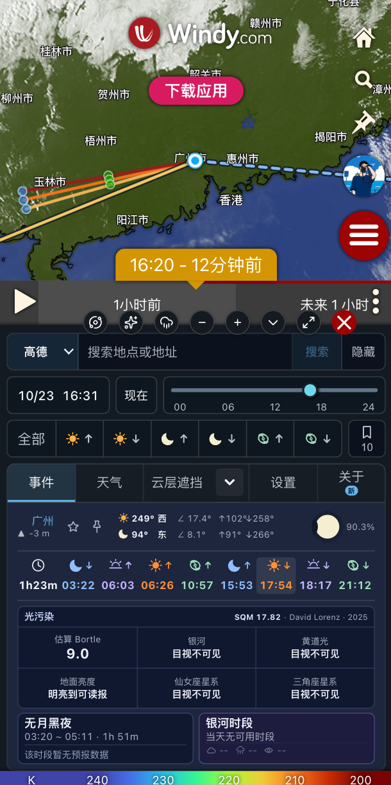
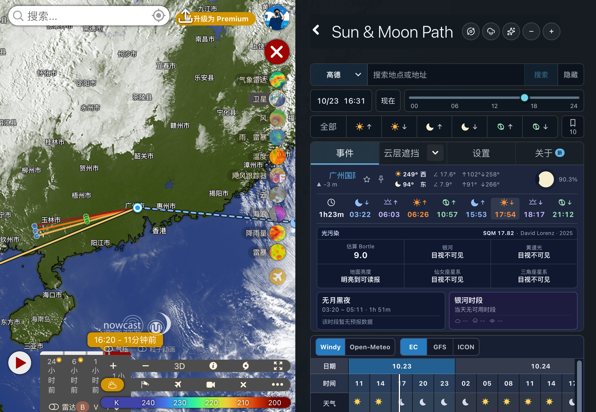

# Sun & Moon Path for Windy

**中文** · [English](README_EN.md)

在 Windy 地图上规划日出、日落、月亮、银河、朝晚霞、火烧云与彩虹拍摄，结合天体方向、云层距离、天气与收藏机位选择拍摄时机。支持中英文、桌面端与移动端。

**移动端**



**桌面端**



## 安装与上手

当前发布版本：**0.11.4** · [更新记录](https://github.com/bytepoem/windy-plugin-sun-moon-path/releases/tag/0.11.4)

将以下地址填入 Windy 的外部插件加载入口，打开 **Sun & Moon Path**：

```text
https://windy-plugins.com/17629746/windy-plugin-sun-moon-path/0.11.4/plugin.min.js
```

1. **选机位**：点击地图，或输入 WGS84 / GCJ-02 坐标。中文地点搜索需在设置中填写自己的地图服务 API Key。
2. **选时间**：选择日期，通过当地时间条或日月、银心升落按钮跳转到拍摄时刻。
3. **看条件**：查看事件与天气，使用云层或彩虹规划，也可选择 2–5 个收藏机位进行对比。

语言和显示选项在「设置」中调整；详细图例见「设置 → 使用说明」。以下功能说明对应当前仓库，已发布版本的功能以更新记录为准。

更新检查按网络地区选择来源：中国大陆及地区未知时使用 Gitee，其他已知地区使用 GitHub。代理可能影响判断；检查失败时可在「关于」重试。

## 主要功能

| 功能 | 用途 |
| --- | --- |
| 日月与银河 | 查看升落时刻、方向线、月相、无月和银河观测时段，用天空盘辅助构图 |
| 云层规划 | 选择太阳、月亮或银心，结合预报或手动云高查看云距与视线交点，为朝晚霞、火烧云等拍摄提供云区参考；支持单层、分层和卫星云图对照 |
| 彩虹规划 | 查看日虹／月虹的方向和高度，支持双虹、完整圆圈，以及主虹条件评估 |
| 潮汐规划 | 自动获取 Open-Meteo 模型水位，对照日出日落并同步拍摄时间，无需 Key |
| 天气与观测 | 选择 Windy / Open-Meteo 数据源及预报模型，结合天气、月光和目标位置查看观测时段 |
| 收藏对比 | 复用 Windy 收藏，比较机位的天气、天文事件、海拔与光污染 |
| 光污染地图 | 叠加 Lorenz 2025 天空亮度地图，结合机位 SQM 与估算 Bortle 筛选暗夜拍摄地点 |
| 雷达与显示 | 按中央气象台分段色阶叠加 RainViewer 雷达；单位跟随 Windy，移动端支持收起、小窗口与全屏 |

## 功能怎么用

### 日月与银河

选好机位和日期，进入「事件」查看日月升落、月相、无月和银河观测时段。点击升落按钮或事件时刻跳转，再调整当地时间条，结合方向线和天空盘判断构图方向。

可在「设置」中切换「显示天空盘」，或使用窗口栏首个天体轨道图标按钮；两处同步并记住选择。

### 云层规划

进入「云层遮挡」，选择太阳、月亮或银心及拍摄时刻。选择单层或分层，再选预报云高来源；已知云层海拔时也可手动输入。结合地图视线交点、云距参考线和预报云图判断需要关注的云区，卫星云图可用于对照当前实况。

拍摄朝晚霞或火烧云时，可选择太阳并结合日出、日落时刻，参考目标方向的云区和天气条件；这不是朝晚霞或火烧云出现预报。

### 彩虹规划

在「云层遮挡」旁的下拉菜单选择「彩虹」，选择日虹或月虹并调整时间。地图显示虹弧方向与高度，实线表示地平线上，虚线表示地平线下；所选光源低于地平线时不显示虹弧。

「彩虹时段」显示当地主虹的几何窗口及持续时间，开启双彩虹后同时显示副虹。时段仅表示光源和部分虹弧在水平地平线上，不是彩虹出现预报。

点击「评估当前时刻」，查看主虹方向上的降雨、光照，以及独立的地形和沿途低能见度参考。可调整相机离地高度辅助判断地形影响。

**虹弧只用于几何构图，条件等级不是出现概率。** 评估使用小时预报和有限采样，可信度低，不证明同一瞬间雨滴受到光照；月虹不参与条件评估。山体提示不代表彩虹一定被挡，“未发现遮挡”也不代表视线畅通。双虹或完整圆圈能否看到，仍取决于受光水滴和现场视线。

### 地平线

可切换总云、低云、中云、高云、云底高度或卫星云图，选择预报模型，并查看底图预报时次。开启同步后，预报云图跟随顶部日期和时间；卫星影像时间以 Windy 时间轴为准。云图选项与「云层遮挡」共用。

在「云层遮挡」旁的下拉菜单选择第三项「地平线」，默认读取、展示并填入当前定位点海拔，地图自动适配地平线半径范围。顶部按钮筛选日、月和银心升落方向，「全部」显示六个方向；地图只绘制所选方向的地平线方位线和距离，不叠加事件前后或实时方向线。可手动修改视点总海拔以计入楼顶或相机离地高度；换地点后恢复自动海拔，读取失败可重试。修改高度后可用范围按钮重新适配，计算方法见面板说明。这里估算的是到海平面切点的距离，不是最远可见物体的距离；不修改升落时刻，不包含折射、地形、建筑或云层遮挡，不能保证实际视线畅通。

### 潮汐规划

从摄影规划下拉菜单选择「潮汐」，自动加载当前机位的 Open-Meteo 模型水位，无需注册或填写 Key。曲线与日出日落对齐，统一使用顶部时间条调整拍摄时间；点击估算高低水位或日光事件也可同步顶部拍摄时间。右上角可切换曲线与表格，表格按面板宽度分两组或三组展示当天全部可用小时数据。

可选择机位当地今天起 10 天内的日期，实际覆盖以模型数据为准。内陆、部分河口或日期可能无数据，仍可使用日光时刻。数据来自 [Open-Meteo Marine API](https://open-meteo.com/en/docs/marine-weather-api)，免费接口限非商业用途并有请求限额，使用须遵守其[条款](https://open-meteo.com/en/terms)与[署名许可](https://open-meteo.com/en/license)。

**模型水位仅供摄影参考，不代表机位水深或通行安全。** 水位相对全球平均海平面（MSL），包含潮汐及气压等影响，不是港口潮汐表或浪高。模型分辨率约 8 km，近岸误差可能较大；高低水位时刻由逐小时曲线估算，以「约」标示，不能用于航行。

### 天气与观测

进入「天气」，在天气表中选择数据源和预报模型，查看目标时段的云量、降水、风和能见度等条件。结合观测时段、月光和目标位置选择拍摄时间；切换来源或模型后重新比较，缺测项按未知处理。

### 收藏对比

点击顶部收藏按钮，可收藏当前机位，也可搜索并打开已有的 Windy 收藏。点击「对比」，选择 2–5 个地点后「开始对比」，查看同一日期的天气、观测时段、海拔与光污染，筛选备选机位。

### 光污染地图、雷达与显示

点击降雨云图标旁的星光按钮可叠加 Lorenz 2025 光污染地图，默认关闭，开启时默认不透明度为 50%。在「设置」中调整不透明度、查看加载状态或重试；开关和不透明度会记住上次选择。点击地图仍可查看机位的 SQM 与估算 Bortle。地图与机位查询使用同一年度数据，覆盖南纬 65° 至北纬 75°，不随天气时间轴变化。它是天顶天空亮度模型，不是实时观测或实测 Bortle 分级。数据与色阶说明来自 [David Lorenz](https://djlorenz.github.io/astronomy/lp/)。

点击降雨云按钮快速开关 RainViewer 雷达，也可在「设置」中选择雷达来源并调整透明度。回波按中央气象台分段色阶显示，结合 Windy 时间轴和显示的雷达时次查看降雨变化；配色不改变数据来源，回波范围和更新时间可能与 Windy 原生雷达不同。语言与显示选项也在设置中调整，计量单位跟随 Windy；手机上可用面板控制按钮切换收起、小窗口或全屏。

「最小化范围」默认保持当前收起效果，也可进一步隐藏当天事件时间栏，或同时隐藏地点、日月方位与月相栏。展开后恢复完整内容，选择会保存在当前浏览器。

## 使用边界

- **规划时间与现在不同。** 共用时间条按机位当地时区显示，刷新或重新打开时回到当前时间；标有 `now` 的日月方向线始终表示真实当前时刻。
- **天空盘表示方向，不表示距离。** 银河带和虹弧是几何示意，线宽不代表实际角宽，也不保证可见。
- **云距是几何参考。** 当前点云高不代表远方云区，云距计算不检查沿途天气、地形或云厚，不保证目标可见，也不保证出现朝晚霞或火烧云。详见[云层计算原理与限制](docs/cloud-obstruction.md)。
- **数据来源与时次有区别。** 天气、观测时段和收藏对比共用所选来源；自动云高来自 Windy，卫星和雷达显示各自实况时次。缺测保留未知，不自动换源。
- **预报不等于实况。** Open-Meteo 小时降水为前一小时累计量；过去时段的模式数据不是现场观测。请结合最新天气与现场情况判断。

## 本地开发

当前 CI 使用 Node.js 24、npm 11.12.1。

```sh
npm exec --yes --package=npm@11.12.1 -- npm install
npm test
npm start
```

打开 [Windy Developer mode](https://www.windy.com/developer-mode)，加载 `https://localhost:9999/plugin.js`。

运行 `npm run build` 生成 `dist/`，包含脚本、`plugin.json` 和截图。维护文档：[预报请求与组件职责](docs/refactor-0.11.0.md) · [更新托管与发布](docs/update-hosting.md)。

## 反馈与许可

界面显示不完整或加载异常时，可展开「关于」底部的「查看诊断信息」并复制报告，随问题反馈提供。初始化失败时也会显示诊断入口。报告包含版本、运行环境、加载状态和脱敏错误，不包含机位坐标、收藏或 API Key；插件文件本身未能加载时，仍需提供截图和浏览器错误信息。

[提交问题或建议](https://github.com/bytepoem/windy-plugin-sun-moon-path/issues) · [作者 bytepoem](https://github.com/bytepoem) · [小红书关注](https://xhslink.cn/o/rXpBcBK0Qy) · [爱发电自愿打赏](https://afdian.com/a/bytepoem) · [MIT License](LICENSE)
