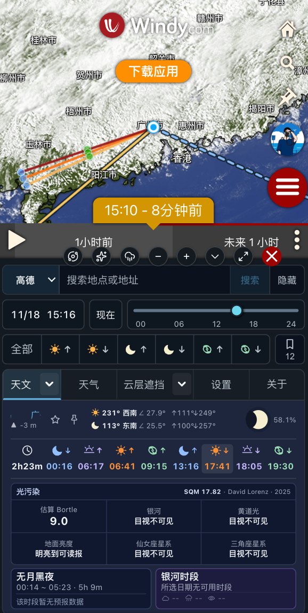
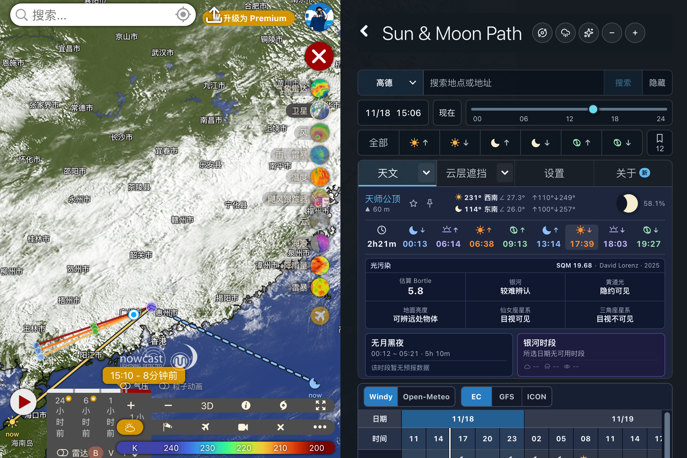

# Sun & Moon Path for Windy

[](https://github.com/bytepoem/windy-plugin-sun-moon-path/releases/latest)
[](https://github.com/bytepoem/windy-plugin-sun-moon-path/actions/workflows/validate.yml?query=branch%3Amain)
[](https://github.com/bytepoem/windy-plugin-sun-moon-path/stargazers)
[](LICENSE)

[中文](README.md) · **English**

Plan photography of sunrise, sunset, the Moon, Milky Way, sunrise and sunset glow, fiery clouds and rainbows on Windy. Use celestial directions, cloud distances, weather and favorite-location comparisons to choose when and where to shoot. Supports the 42 languages in Windy Settings on desktop and mobile.

**Mobile**



**Desktop**



## Install and get started

Update checks use Gitee for mainland China or an unknown network region, and GitHub for other known regions. Proxies may affect detection; failed checks can be retried in About. This describes the current repository; released behavior is listed in the release notes.

Current release: **0.13.1** · [Release notes](https://github.com/bytepoem/windy-plugin-sun-moon-path/releases/tag/0.13.1)

Paste this URL into Windy's external plugin loader, then open **Sun & Moon Path**:

```text
https://windy-plugins.com/17629746/windy-plugin-sun-moon-path/0.13.1/plugin.min.js
```

1. **Choose a location:** click the map or enter WGS84 / GCJ-02 coordinates. Chinese place-name search requires your own map-service API Key in Settings.
2. **Choose a time:** select a date, then use the local time strip or Sun, Moon and galactic centre rise/set shortcuts. All date selectors start no earlier than January 1 of the previous year, based on the browser’s current year, and advance at New Year.
3. **Check conditions:** explore events and weather, use cloud or rainbow planning, or compare 2–5 favorite locations.

The plugin follows the language actually used by Windy by default and supports the 42 languages in Windy Settings. Choose a separate language at the top of Settings, or switch back to `auto` to follow Windy. Manual choices, including existing ones, are remembered. New languages are machine translated with AI language checks and have not been reviewed by native speakers of every language; cloud-guide images and historical update notes remain in Chinese or English. Display options are also in Settings, with detailed legends under Settings → Guide. The features below describe the current repository; refer to release notes for published-version availability.

Simplified Chinese and English are built in and need no language download. The other 40 languages load individually on first use and are cached in this browser after validation. Retry a failed load, or temporarily use English at startup while keeping your saved language preference. Short dates always use month/day; full dates retain year-month-day, regardless of interface language. Non-Chinese interfaces use `All` and `Now` for the compact buttons, with full descriptions in the selected language. Long language names end with an ellipsis; open the selector to see the full options.

Startup layer choices include layers supported by the plugin and available in the current Windy runtime, including Flight dangers, City heatmaps, Thermals and Outdoor map. You can also keep Windy's current layer.

The desktop title back button supports keyboard focus. Astro and Clouds tabs use narrow dropdown arrow buttons with compact spacing; their menus support arrow keys to choose, Enter to confirm and Escape to close. Horizontal tables remain focusable for keyboard scrolling.

## Features

| Feature | Purpose |
| --- | --- |
| Sun, Moon and Milky Way | Rise/set times, direction lines, Moon phase, moonless and Milky Way observing windows, plus a sky chart; compare seven days of windows or pick astronomical dates in a month |
| Cloud planning | Select the Sun, Moon or galactic centre and use forecast or manual cloud heights to view distances and sightline intersections as cloud-region references for sunrise/sunset glow, fiery clouds and other photography; supports single/layered views and satellite comparison |
| Rainbow planning | Sunbow/moonbow directions and altitudes, double bows, full circles and primary-bow condition assessment |
| Tide planning | Automatically load Open-Meteo model water levels, compare sunlight events and synchronize shooting time without an API key |
| Weather and observing | Choose a Windy / Open-Meteo forecast model, check clouds, precipitation, snowfall and ground snow depth, and find observing windows using moonlight and target position |
| Favorite comparisons | Reuse Windy favorites to compare weather, astronomical events, elevation and light pollution by whole day, target window or custom period |
| Light pollution map | Overlay Lorenz 2025 sky brightness and use location SQM and estimated Bortle values to shortlist dark-sky photography sites |
| Radar and display | RainViewer overlays using the China NMC stepped reflectivity palette, Windy units, and collapsed, compact or fullscreen mobile views |
| Feedback | Open the bilingual form in About to report bugs, suggest features or share other feedback |

## How to use the features

### Sun, Moon and Milky Way

Choose a location and date, then open Astro for Sun/Moon rise and set times, Moon phase, moonless periods and Milky Way observing windows. Select a rise/set shortcut or event time, then adjust the local time strip and use direction lines and the sky chart to plan your composition.

Cloud cover, precipitation and visibility appear below the moonless and Milky Way windows. A message under the time row indicates when there is no window for the date or forecast coverage is missing or partial.

Choose Multi-day overview from the Astro dropdown to compare seven days of moonless, Milky Way or sunset ±1 hour windows and weather within each window. Monthly astronomy covers 30 consecutive days. Expanding a date keeps map time; choosing Single-day events within a window jumps to that time. Return through the Astro dropdown to preserve the browsing range. Segmented buttons at the top of the seven-day overview switch between Windy / Open-Meteo sources and EC / GFS / ICON models. Controls use a compact layout, with window rules folded under Guide. Nights belong to the local-noon-to-next-noon period, with separate segments; Moon phase is calculated at noon. Weather uses the selected source and model, retaining partial coverage, out-of-range, missing-data and loading-failure states. Monthly bars show astronomical duration, not weather scores or shooting success probabilities.

Monthly calendars start on Sunday. Saturdays and Sundays use warm, bold, underlined dates in both the monthly grid and seven-day overview. The seven-day overview still begins on the selected observing date.

Seven-day windows show weather conditions, cloud cover, wind, precipitation, temperature, humidity, visibility, AOD and dew point, with expandable original forecast samples. The Snow display setting also controls new snow and ground snow depth. Precipitation and new snow retain full overlapping source accumulations and their periods. Other ranges use samples inside the window. Short windows without instantaneous samples can still show overlapping accumulations. AOD, visibility and supplementary ground snow depth can be retried separately.

Switch the date layout between Vertical and Horizontal beside the date. Horizontal is the default: seven dates form columns and metrics form rows. Vertical places dates in rows and metrics in columns. The overview keeps the same panel height as other tabs, with content scrolling inside. Scroll horizontally when needed; the first column stays fixed for reference. Chinese observing-date and forecast-range headings use two lines split at word boundaries. Select a date to view full windows and original samples below the table. Only Single-day events changes map time; separate windows retain separate weather ranges. Metrics use the weather table icons with small names below them; hover for details such as the precipitation rule.

Toggle “Show sky chart” in Settings or use the first window button with the orbit icon; both controls stay synchronized and remember your choice.

### Cloud planning

Open Clouds and select the Sun, Moon or galactic centre and a shooting time. Choose a single or layered view and a forecast cloud-height source, or enter a known cloud altitude manually. Use sightline intersections, distance references and forecast cloud maps to identify cloud regions of interest; satellite imagery provides a comparison with current observations.

For sunrise/sunset glow or fiery cloud photography, select the Sun and use sunrise/set times to explore cloud regions and weather in your shooting direction. This does not forecast the occurrence of colorful skies or fiery clouds.

### Rainbow planning

Choose **Rainbow** from the dropdown beside Clouds, select Sun or Moon, and adjust the time. The map shows bow directions and altitudes: solid arcs are above the horizon, dashed arcs below it. Bows are hidden when the selected light source is below the horizon.

**Rainbow windows** lists local primary-bow geometric windows and their duration; Double also shows secondary-bow windows. These only indicate the source and part of the bow above the horizontal horizon, not a forecast of rainbow occurrence.

Select **Assess selected time** to check rain and sunlight along primary-bow directions, with separate terrain and route low-visibility references. Adjust camera height above ground to explore terrain effects.

**Bow geometry is a composition reference; condition grades are not probabilities.** Assessment uses hourly forecasts and limited samples, always with low confidence. It cannot prove that droplets are illuminated at the same instant; moonbows are not assessed. Terrain warnings do not prove the bow is blocked, and no detected obstruction does not guarantee a clear view. Seeing a double bow or full circle still depends on lit droplets and actual sightlines.

### Horizon

The event table lists rise/set bearings and times for the Sun, Moon and galactic centre in the current location’s time zone; ocean locations use the nautical time zone provided by Windy. A notice appears when an event does not occur that day.

Switch between total, low, middle or high clouds, cloud base and satellite imagery; select a forecast model and check the map's forecast time. With synchronization enabled, forecast maps follow the shared date and time controls; satellite image time follows the Windy timeline. Cloud map preferences are shared with Clouds.

Choose **Horizon**, the third option in the dropdown beside Clouds. It reads and displays the current location elevation, fills the height field and fits the map to the horizon radius. Use the top buttons to filter Sun, Moon and galactic centre rise/set directions; All shows all six. The map draws only the selected horizon bearings and distances, without before/after-event or live direction lines. Manually enter total observer elevation to include rooftop or camera height; a new location restores auto elevation, and failed reads can be retried. After changing height, use the fit button to fit again; the panel guide explains the calculation. This estimates distance to the sea-level tangent point, not the farthest visible object. It does not adjust event times or account for refraction, terrain, buildings or clouds, and cannot guarantee a clear view.

### Tide planning

Select **Tides** from the planning dropdown to automatically load Open-Meteo model water levels for the camera location. No registration or API key is needed. Compare the curve with sunlight events and use the top time strip to adjust shooting time. Selecting estimated high/low levels or sunlight events also updates the shared shooting time. Use the top-right icon to switch between curve and table; the table shows all available hourly readings for the day in two or three groups depending on panel width.

Choose dates within ten days from today at the camera location; actual coverage depends on model availability. Inland locations, some estuaries or dates may have no data; sunlight events remain available. Data comes from the [Open-Meteo Marine API](https://open-meteo.com/en/docs/marine-weather-api). Its free API is for non-commercial use with request limits, subject to its [terms](https://open-meteo.com/en/terms) and [attribution licence](https://open-meteo.com/en/license).

**Model water levels are for photography reference, not camera-location water depth or access safety.** Levels are relative to global mean sea level (MSL), including tides and pressure effects, not port tide tables or wave heights. Model resolution is about 8 km, with limited coastal accuracy. High/low times are estimated from hourly samples and marked approximately; they must not be used for navigation.

### Weather and observing

Open Weather and choose a data source and forecast model. Check cloud cover, precipitation, wind speed, gusts and visibility for your target period, alongside observing windows, moonlight and target position. Compare again after changing sources or models, and treat missing values as unknown.

Snow rows appear below precipitation. Windy estimates new snow for each forecast step using 1 mm of snow water equivalent to represent about 1 cm of new snow. The values appear in the Estimated new snow row. The selected Open-Meteo model supplies ground snow depth. The Open-Meteo weather table shows new snow for the preceding hour. Ground snow depth is valid at the labeled time. Open-Meteo shows one, two or three snowflakes for light, moderate or heavy snow according to the weather code.

Both sources can summarize 24 hours of new snow from the first forecast step of the selected date. Windy shows its estimated depth, and Open-Meteo also shows snow water equivalent. Complete positive water equivalent totals are graded under GB/T 28592—2012. Under Settings → Snow display, choose Show when snow is forecast, Always show or Hide. By default, each snow row or summary appears when it has a positive value.

The weather table and seven-day overview show the status of supplementary data in the Open-Meteo notice. AOD, supplementary visibility and ground snow depth can each be retried independently while loaded values remain available. Open-Meteo weather uses visibility from the selected model. Favorite comparisons also retain available metrics and mark failed ones as Load failed. Refresh comparison reloads the entire comparison.

See Settings → Guide → Weather legend for 24-hour snow water equivalent grades.

### Favorite comparisons

Use the top favorites button to save the current location or search and open existing Windy favorites. Select Compare, choose 2–5 locations and start the comparison to check weather, observing windows, elevation and light pollution for the same date and shortlist alternative shooting locations.

Whole day summarizes weather for each site's local date. Open-Meteo precipitation includes accumulation periods that overlap that local date. Target window supports moonless or Milky Way windows, or one hour before and after sunset. All windows intersecting the selected date are included by default, with a per-site option to select one segment. Windows crossing midnight show both dates.

OM in Data source means Open-Meteo. Data source, Period and the target-window selector share a compact toolbar and wrap when space is limited.

Custom period uses local dates and times for sites in one time zone. Use the next date when crossing midnight. For sites in different time zones, choose Whole day or Target window. Custom periods begin no earlier than January 1 of the previous year, based on the browser’s current year; dates outside the forecast range may still have no weather data. Expand Conditions through the period to inspect original cloud, wind and precipitation samples without interpolation. Precipitation retains complete source accumulation periods without proration or summation. Forecast range, partial coverage, outside range, missing data and loading failures are shown separately; unknown conditions do not mean good weather.

After leaving cloud planning, All restores event directions. When cloud heights are unknown, the fit button fits existing direction lines and the zoom-in button restores the location zoom.

### Light pollution map, radar and display

Use the sparkles button beside the rain-cloud icon to overlay the Lorenz 2025 light pollution map. It defaults to off with 50% opacity when enabled. Adjust opacity, check loading status or retry in Settings; the toggle and opacity remember your choices. Selecting a location still shows its SQM and estimated Bortle values. The map and location query use the same annual data, covering 65°S–75°N independently of the weather timeline. This is a zenith sky brightness model, not a live observation or measured Bortle classification. Data and color key: [David Lorenz](https://djlorenz.github.io/astronomy/lp/).

Use the rain-cloud button to toggle RainViewer radar, or select the source and adjust opacity in Settings. Echoes use the China NMC stepped reflectivity palette; use Windy's timeline and the displayed radar timestamp to examine changes in rainfall. Recoloring does not change the data source, so echo coverage and update times may differ from Windy's native radar. Settings also contains language and display options, while measurement units follow Windy. On mobile, use the panel controls to switch between collapsed, compact and fullscreen views.

Minimize scope keeps the standard collapsed layout by default. Choose to hide event times for the selected date, or hide both event times and the location, Sun/Moon directions and Moon phase row. Expanding restores all content, and your choice is saved in this browser.

## Usage limits

- **Planning time differs from now.** The shared time strip uses the location's time zone and resets to the current time when refreshed or reopened. Sun/Moon lines labeled `now` always show the actual current instant.
- **Sky charts show directions, not distances.** Milky Way bands and rainbow arcs are geometric illustrations; stroke widths are not actual angular widths or visibility guarantees.
- **Cloud distances are geometric references.** Local cloud heights do not describe distant clouds. Cloud-distance calculations do not check weather, terrain or cloud thickness along the path and cannot guarantee visibility, sunrise/sunset glow or fiery clouds. See [cloud calculation principles and limits](docs/cloud-obstruction.md) (Chinese).
- **Sources and timestamps differ.** Weather, observing windows and favorite comparisons share the selected source. Automatic cloud heights come from Windy; satellite and radar show their own observation times. Missing data remain unknown without automatic source switching.
- **Forecasts are not observations.** Open-Meteo hourly precipitation covers the preceding hour; past model data are not on-site observations. Check current weather and conditions in the field.

## Local development

Current CI uses Node.js 24 and npm 11.12.1.

```sh
npm exec --yes --package=npm@11.12.1 -- npm install
npm test
npm start
```

Open [Windy Developer mode](https://www.windy.com/developer-mode) and load `https://localhost:9999/plugin.js`.

Run `npm run build` to generate `dist/`, including scripts, `plugin.json` and the screenshot. Maintenance notes (Chinese): [forecast request and component responsibilities](docs/refactor-0.11.0.md) · [update hosting and publishing](docs/update-hosting.md).

## Feedback and license

Choose **Feedback** below the author support button in **About**, or open the [feedback form](https://tally.so/r/jeoe2Q), to report bugs, suggest features or share other feedback. Feedback type, details and plugin version are required; screenshots, device and browser details, and email are optional. Successful submissions redirect to the author support page; donations are entirely optional.

If the interface is incomplete or loading fails, expand **View diagnostics** at the bottom of **About**, copy the report and include it with your issue. A diagnostic entry is also shown when initialization fails. Reports include the version, environment, loading states and sanitized errors, excluding location coordinates, favorites and API keys. If the plugin file itself cannot load, provide screenshots and browser errors instead.

[Feedback form](https://tally.so/r/jeoe2Q) · [GitHub Issues](https://github.com/bytepoem/windy-plugin-sun-moon-path/issues) · [Author: bytepoem](https://github.com/bytepoem) · [RedNote](https://xhslink.cn/o/rXpBcBK0Qy) · [Optional support on Afdian](https://afdian.com/a/bytepoem) · [MIT License](LICENSE)
