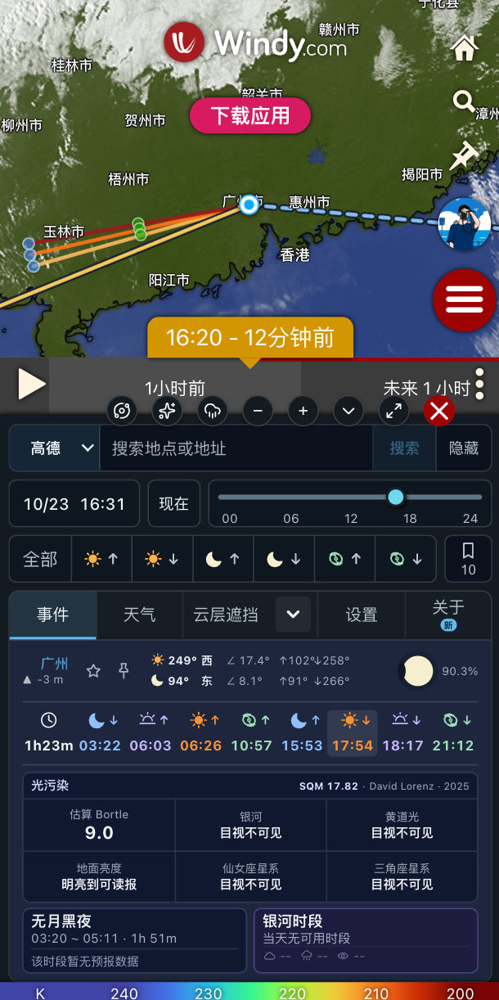
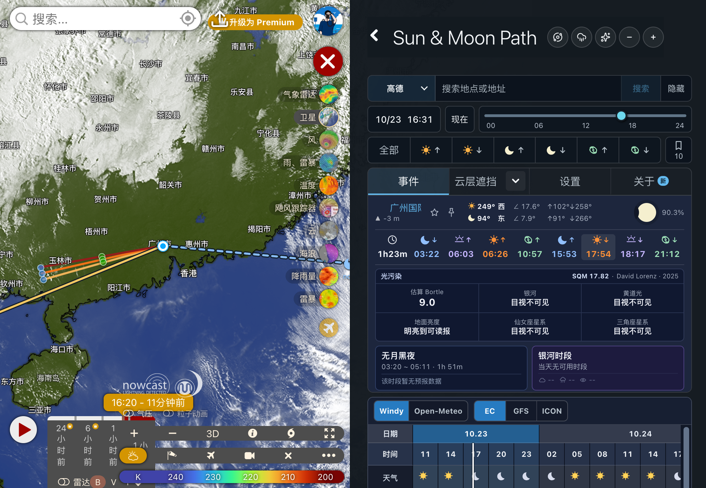

# Windy 上架审核帖子 · 0.12.5

以下为待发布文案，不代表 Windy 已审核通过或插件列表已更新。英文版可直接用于 Windy 社区审核申请。

## English

### Title

Sun & Moon Path 0.12.5 — plugin listing review request

### Post

Hi Windy team,

I'd like to submit Sun & Moon Path 0.12.5 for review and listing in the Windy plugin directory.

Sun & Moon Path helps photographers plan the Sun, Moon and Milky Way alongside Windy's weather maps. It supports Chinese and English, with desktop and mobile layouts.

Main features:

- Sun, Moon and Galactic Center directions, rise/set times, a sky chart, and moonless-night and Milky Way observation windows.
- Cloud-distance and celestial sightline estimates, rainbow planning, a geometric horizon view and tide planning.
- Weather forecasts from Windy and Open-Meteo, with saved-location comparisons for choosing between photography spots.
- Optional radar and light-pollution overlays, with source attribution and display controls.

Version 0.12.5 fixes a Settings rendering error triggered by Windy's Flight dangers layer. The error could leave Settings blank and prevent subsequent navigation to other tabs. This release supports the layer's bilingual label and validates startup layer choices before displaying them.

Cloud obstruction and rainbow sightlines are geometric estimates, not guarantees of visibility. Weather and tide forecasts also have source and coverage limits, explained in the in-plugin guide.

Plugin URL:
https://windy-plugins.com/17629746/windy-plugin-sun-moon-path/0.12.5/plugin.min.js

Source code: https://github.com/bytepoem/windy-plugin-sun-moon-path

Release notes: https://github.com/bytepoem/windy-plugin-sun-moon-path/releases/tag/0.12.5

License: MIT

The existing screenshots are retained for this maintenance release:

Thank you for reviewing the plugin. Please let me know if any changes are needed for listing.

## 中文

### 标题

Sun & Moon Path 0.12.5 — 插件上架审核申请

### 正文

Windy 团队好，

申请审核 Sun & Moon Path 0.12.5，并将其加入 Windy 插件列表。

这是一款面向摄影规划的插件，将太阳、月亮、银河与 Windy 天气地图结合，支持中英文和桌面、移动布局。

主要功能：

- 查看太阳、月亮、银心方位与升落时间、天空盘，以及无月黑夜和银河观测窗口。
- 参考云层距离与天体视线估算，进行彩虹、几何地平线和潮汐规划。
- 查看 Windy／Open-Meteo 天气预报，对比收藏机位，辅助选择拍摄位置。
- 按需显示雷达与光污染图层，并提供来源署名和显示控制。

0.12.5 修复了 Windy 飞行危险图层触发的设置页渲染异常。此前该异常可能造成设置空白，并使后续 Tab 切换失去响应；本版补全该图层的中英文名称，并在展示启动图层选项前校验支持范围。

云层遮挡与彩虹视线属于几何估算，不保证实际可见；天气和潮汐预报也受数据来源与覆盖范围限制，具体说明见插件内使用说明。

插件地址：
https://windy-plugins.com/17629746/windy-plugin-sun-moon-path/0.12.5/plugin.min.js

源代码：https://github.com/bytepoem/windy-plugin-sun-moon-path

更新记录：https://github.com/bytepoem/windy-plugin-sun-moon-path/releases/tag/0.12.5

许可证：MIT。本次维护版本沿用上方既有截图。

感谢审核，如需调整以满足上架要求，请告知。
